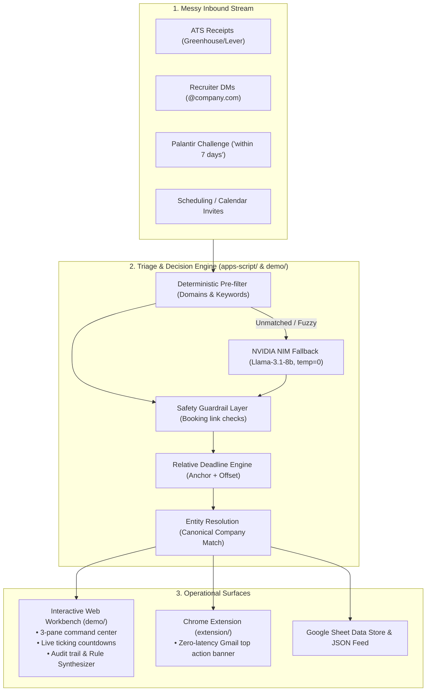

# Job Application Inbox Tracker (Triage Cockpit)

---

## 1. The Friction (Why This Exists)
When applying to 30+ roles, Gmail turns into a chaotic, unstructured stream. Rejections, recruiter direct emails, take-home exercises, and interview invites from dozens of disparate ATS platforms (`greenhouse.io`, `lever.co`, `ashbyhq.com`, `myworkdayjobs.com`) arrive as flat, disconnected threads.

The catalyst for this project was **Palantir's own challenge email**:
> *"Please send your submission to [designchallenge@palantir.com] **within 7 days of receiving this email**"*

In a standard Gmail inbox, this deadline is invisible. There is no calendar event, no reminder, and no absolute date. It gets buried between automated ATS receipts and ambiguous updates.

---

## 2. Core Architectural Principle: "AI Only Reads. Code Decides."

Enterprise product designers do not trust probabilistic LLMs with critical operational actions. A naive LLM might see the phrase *"Unfortunately, our interviewer is out sick..."* and classify the email as a rejection, auto-archiving an interview invite.

In this architecture:
- **AI only extracts:** The model (NVIDIA NIM `meta/llama-3.1-8b-instruct`) extracts structured parameters (`company`, `role`, `stage`, `raw_deadline_phrase`) with confidence bounds.
- **Deterministic Code Decides:** Strict rules govern whether an email is labeled, starred, or archived.
- **Safety Guardrails:** Any message containing scheduling or calendar links (`calendly.com`, `goodtime.io`) is permanently protected from archiving, overriding any negative LLM sentiment.

---

## 3. System Architecture



---

## 4. Key Product Design Features

### A. Three-Column High-Density Workbench (`demo/`)
1. **Left: Raw Ingestion Stream:** Shows incoming messages with stage badges, confidence scores, and safety override alerts.
2. **Center: Application Entity Board (Ontology Model):** Groups fragmented emails (ATS confirmation + recruiter DM + take-home prompt) into **one single company entity** with an interactive chronological event timeline.
   - **Needs Action (Urgent):** Sorted strictly by relative deadline countdowns.
   - **In Progress:** Active interview and take-home loops.
   - **Ghosted (60+ days with no reply after applying):** Automatically detects stale pipelines and provides a 1-click **Contextual Nudge** draft.
   - **Closed & Archived:** Rejections auto-archived with zero inbox cognitive fatigue.
3. **Right: Decision Audit Trail ("AI Reads, Code Decides"):**
   - **Relative Deadline Resolution Engine:** Displays the mathematical derivation from raw phrases (e.g. `Received: Oct 20, 11:15 AM` $+$ `7 Days` $\rightarrow$ `Due: Oct 27, 11:15 AM` $\rightarrow$ Live ticking badge).
   - **AI Failure Mode Deep Dive:** Highlights where the LLM hallucinated rejection and how deterministic regex caught the Calendly link to protect the candidate.
   - **Human-in-the-Loop Rule Synthesizer:** User corrections are instantly converted into permanent deterministic rules so the AI never repeats the same error.

### B. Job Tracker inside Gmail (`extension/`)
Manifest V3 Chrome extension (InboxSDK) that adds **Job Tracker** to Gmail's sidebar. Clicking it shows the dashboard in the same tab: counts per stage, a to-do list with deadlines, weekly counts and a stage board of every application. Clicking an item opens the real email.

### C. Google Apps Script (`apps-script/`)
Runs every 5 minutes with **read-only** Gmail access (it can't label, star or archive). A small classifier trained on my own labelled mail (`trainer/train.js` → `Model.gs`) sorts each email; anything it isn't sure about is marked `review` instead of guessed. Code works out companies and deadlines ("within 7 days of receiving this email" → a real date) and writes one row per email to a Google Sheet, which the dashboard reads.

---

## 5. The 160-Second Video Walkthrough Script

* **0:00 – 0:25 | The Hook & Friction:**
  > *"When Palantir invited me to this challenge, the instructions said: 'Please send your submission within 7 days of receiving this email.' No date, no calendar invite. It landed between 30 other ATS automated rejections and confirmations. Job hunting is a high-stakes operational problem, but Gmail treats it like a flat text stream where deadlines get buried. I built this tool to turn that unstructured stream into a deterministic decision workbench."*
* **0:25 – 1:15 | The Live Core Loop & Screen Architecture:**
  > *"Instead of a generic job CRM where you manually type fields, this is an operational triage center. On the left is the raw email stream. In the center is our Application Entity Board. Notice Palantir: our relative deadline parser anchored 'within 7 days' to the received email timestamp and generated this live ticking countdown badge. Notice how personal emails from recruiter Shaun and automated Greenhouse notifications are resolved into a single living application timeline."*
* **1:15 – 2:05 | AI & Trade-offs ("AI Reads, Code Decides"):**
  > *"My core design principle is: AI only reads, code decides. Let me show you an actual AI failure: here is an email from Stripe that starts with 'Unfortunately, our lead is sick today. Please reschedule here on my Calendly...' A standard LLM saw 'Unfortunately' and classified it as a Rejection to be archived! But our deterministic safety guardrail caught the Calendly booking link, overruled the LLM, and kept it in 'Needs Action'. AI proposes parameters; deterministic rules protect the user."*
* **2:05 – 2:35 | What’s Next & Reflection:**
  > *"In 3 hours, I prioritized the triage state machine, entity resolution, and deadline calculation. With another week, I would build automated recruiter cadence follow-ups and bi-directional Gmail add-on sync. Link to test the live demo is in the description."*

---

## 6. Running the Demo Locally

```bash
# 1. Navigate to demo directory
cd demo

# 2. Install dependencies (if not already installed)
npm install

# 3. Start local development server
npm run dev

# 4. Or build and preview production bundle
npm run build
npm run preview
```
Visit `http://localhost:5173` to test the interactive workbench.
